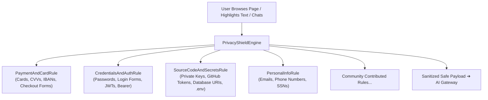

# Wayfinder AI — Open-Source Privacy Shield & Safety Net Engine

## 1. Overview & Core Philosophy

Wayfinder AI is built with an **uncompromising zero-leakage privacy guarantee**. Before any webpage text, prompt, or user interaction is analyzed by AI, it passes through our open-source, client-side **Privacy Shield Engine** (`src/services/privacyShield.js`).

All inspection and redaction occurs **on-device in the browser** before any network request is created.

---

## 2. Architecture & Provider Pattern

The Privacy Shield uses an extensible **Rule Provider Pattern** (`SafetyRule`). Each safety net is an isolated, testable class adhering to the `SafetyRule` interface:



---

## 3. Active Safety Net Protections

| Category | Protection Scope | Redaction Tag / Action |
| :--- | :--- | :--- |
| **💳 Payments & Cards** | Visa, Mastercard, Amex, Discover, CVVs, IBANs, Stripe/PayPal checkout frames | `[CARD_REDACTED]`, `[CVV_REDACTED]`, `[IBAN_REDACTED]`, Halts on checkout pages |
| **🔑 Credentials & Auth** | Password fields, login/signup forms, bearer headers, JWT tokens | `[PASSWORD_REDACTED]`, `[BEARER_TOKEN_REDACTED]`, `[JWT_REDACTED]`, Halts on `/login` |
| **💻 Code & Secrets** | SSH/RSA private keys, GitHub PATs (`ghp_`, `github_pat_`), GitLab tokens, AWS keys (`AKIA`), database URIs (`postgres://`, `mongodb://`), `.env` secrets | `[PRIVATE_KEY_REDACTED]`, `[GITHUB_TOKEN_REDACTED]`, `[AWS_KEY_REDACTED]`, `[DATABASE_URI_REDACTED]` |
| **👤 Personal PII** | US Social Security Numbers, international phone numbers, personal email addresses | `[SSN_REDACTED]`, `[PHONE_REDACTED]`, `[EMAIL_REDACTED]` |

---

## 4. How to Add a Custom Safety Net (Open Source Contribution)

Adding a new safety rule takes just a few lines of code.

### Step 1: Create a Rule extending `SafetyRule`

```javascript
import { SafetyRule, PrivacyShield } from "./privacyShield.js";

export class CryptoWalletRule extends SafetyRule {
  constructor() {
    super({
      id: "crypto_wallets",
      name: "Cryptocurrency Wallet Protection",
      category: "payment",
      description: "Redacts Ethereum and Bitcoin wallet addresses and seed phrases."
    });
  }

  // Redact crypto addresses from text
  sanitizeText(text) {
    return text
      .replace(/\b0x[a-fA-F0-9]{40}\b/g, "[ETH_ADDRESS_REDACTED]")
      .replace(/\b[13][a-km-zA-HJ-NP-Z1-9]{25,34}\b/g, "[BTC_ADDRESS_REDACTED]");
  }
}

// Step 2: Register it in the Privacy Shield singleton
PrivacyShield.registerRule(new CryptoWalletRule());
```

---

## 5. Automated Verification

The Privacy Shield is verified against automated unit tests:
```bash
npx playwright test tests/privacyShield.spec.js
```
