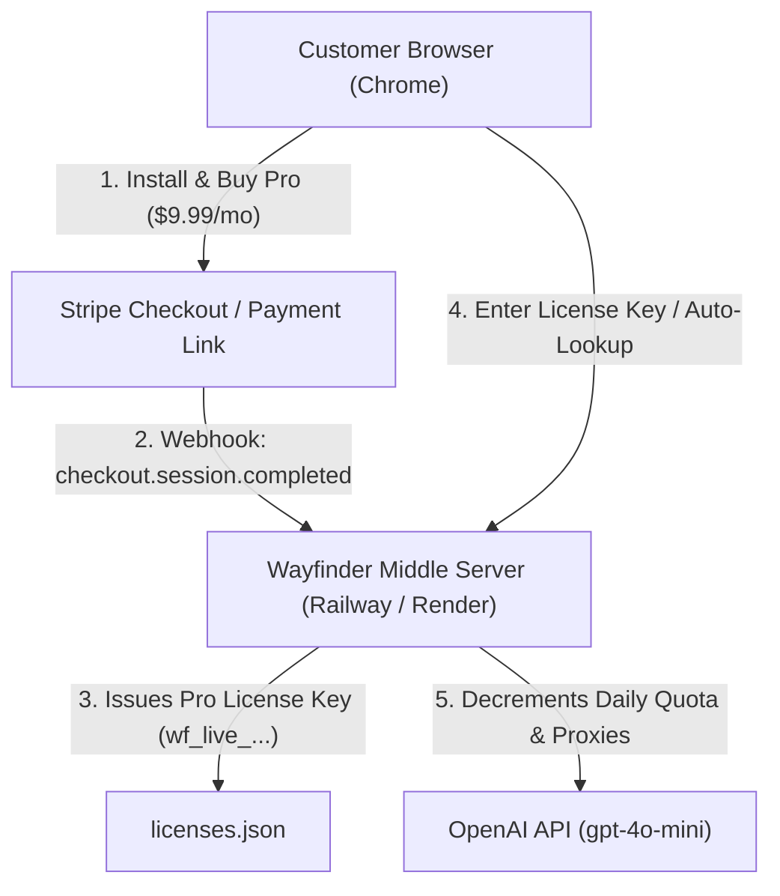

# Wayfinder AI — Production Deployment & Stripe Billing Guide

This guide walks you through launching the Wayfinder middle server to the cloud, setting up Stripe recurring billing, connecting webhooks, and publishing the Chrome Extension.

---

## Architecture Overview



---

## Step 1: Stripe Product & Checkout Setup (5 Minutes)

1. **Log in to your Stripe Dashboard**:
   Go to [https://dashboard.stripe.com](https://dashboard.stripe.com) (use Test Mode first while testing, switch to Live Mode when launching).
2. **Create the Subscription Product**:
   * Navigate to **Product Catalog** -> **Add Product**.
   * **Name**: `Wayfinder AI Pro Subscription`
   * **Description**: `Ambient AI browser copilot with proactive page gotchas, deal comparison, and unlimited guidance.`
   * **Pricing**:
     * Pricing Model: **Standard pricing**
     * Price: **$9.99 USD**
     * Billing Period: **Monthly (recurring)**
   * Click **Save Product**.
3. **Create a Stripe Payment Link**:
   * On the product page, click **Create payment link**.
   * Under **Options**, ensure *Collect customer email* is checked.
   * Under **After payment**, select **Don't show confirmation page** and enter your server redirect URL:
     `https://YOUR-SERVER-DOMAIN.com/checkout/success?email={CHECKOUT_SESSION_CUSTOMER_EMAIL}`
     *(Or simply redirect to `https://YOUR-SERVER-DOMAIN.com/checkout/success`)*.
   * Copy your live Payment Link (e.g. `https://buy.stripe.com/abc123...`). You can place this in your extension popup or website!

---

## Step 2: Cloud Deployment (Railway or Render)

You can deploy to either **Railway** or **Render** in 2 minutes directly from your GitHub repository (`https://github.com/sparsha1211/wayfinderai.git`).

### Option A: Deploy to Railway (Recommended - Fastest)

1. Go to [https://railway.app](https://railway.app) and log in with GitHub.
2. Click **New Project** -> **Deploy from GitHub repo**.
3. Select `sparsha1211/wayfinderai`.
4. Railway automatically detects `railway.json` and `Dockerfile`.
5. Click **Variables** in the project dashboard and add:
   * `NODE_ENV`: `production`
   * `PORT`: `3000`
   * `OPENAI_API_KEY`: `sk-proj-...` (Your private OpenAI secret key)
   * `OPENAI_MODEL`: `gpt-4o-mini`
   * `STRIPE_WEBHOOK_SECRET`: *(leave blank until Step 3)*
6. Click **Settings** -> **Networking** -> **Generate Domain**.
   You will receive a public HTTPS URL like:
   `https://wayfinderai-production.up.railway.app`

### Option B: Deploy to Render

1. Go to [https://render.com](https://render.com) and log in with GitHub.
2. Click **New +** -> **Blueprint** (or **Web Service**).
   * It will read [`render.yaml`](file:///Volumes/Workspace/ai_assist_chrome/render.yaml) automatically.
3. If setting up as a manual Web Service:
   * **Name**: `wayfinder-ai-gateway`
   * **Build Command**: *(leave blank or `npm install`)*
   * **Start Command**: `node server/index.js`
   * **Instance Type**: Free or Starter ($7/mo)
4. Add the Environment Variables:
   * `OPENAI_API_KEY`: `sk-proj-...`
   * `OPENAI_MODEL`: `gpt-4o-mini`
   * `NODE_ENV`: `production`
5. Render generates a public HTTPS URL like:
   `https://wayfinder-ai-gateway.onrender.com`

---

## Step 3: Connect Stripe Webhook to Server (2 Minutes)

1. Open your [Stripe Dashboard Webhooks page](https://dashboard.stripe.com/webhooks).
2. Click **Add destination / Add endpoint**.
3. Set **Endpoint URL**:
   `https://YOUR-SERVER-DOMAIN.com/api/v1/webhooks/stripe`
   *(e.g., `https://wayfinderai-production.up.railway.app/api/v1/webhooks/stripe`)*
4. Under **Select events to listen to**, choose:
   * `checkout.session.completed` (Triggers automatic Pro license creation)
   * `invoice.payment_succeeded` (Renews monthly active status)
   * `customer.subscription.deleted` (Revokes license on cancellation)
5. Click **Add endpoint**.
6. Reveal the **Signing secret** (starts with `whsec_...`).
7. Copy this secret and add it as `STRIPE_WEBHOOK_SECRET` in Railway or Render environment variables!

---

## Step 4: Verify the Entire Deployment

Test the deployed server in your terminal or browser:

```bash
# 1. Health check
curl https://YOUR-SERVER-DOMAIN.com/api/v1/health
# Response: {"status":"ok","service":"Wayfinder AI Gateway","version":"1.0.0"}

# 2. Checkout success page
# Open https://YOUR-SERVER-DOMAIN.com/checkout/success in your browser.
```

---

## Step 5: Package & Publish to the Chrome Web Store

1. Run the automated extension packager:
   ```bash
   npm run package:extension
   ```
   This generates a clean, production-ready zip archive:
   `dist/wayfinder-ai-chrome-extension.zip` (excludes all tests, node_modules, and git history).

2. Open the [Chrome Web Store Developer Dashboard](https://chrome.google.com/webstore/devconsole).
3. Pay the one-time $5 Google Developer registration fee (if not already paid).
4. Click **New Item** -> Drag and drop `dist/wayfinder-ai-chrome-extension.zip`.
5. Fill in the store listing:
   * **Category**: Productivity / Search Tools
   * **Privacy Tab**: Check the boxes for "Does not sell user data", "Does not collect sensitive financial data", and paste the link to your `PRIVACY.md`.
6. Click **Submit for Review** (Google typically approves in 24–48 hours).
