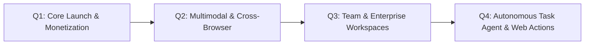

# Wayfinder AI — Product Roadmap & Vision

## 1. Product Vision
To transform the web browser from a passive document viewer into an active, proactive intelligence partner. Wayfinder AI is the ambient layer between the open web and large language models—anticipating user needs, guarding user wallets, and saving time.

---

## 2. Multi-Quarter Development Milestones

---

### Q1: Launch, Monetization & Foundation (Current Phase)
- [x] Complete Chrome Extension Manifest V3 implementation.
- [x] In-page ambient purple callout box system & coordinate overlay layer.
- [x] Autonomous background researcher with cross-site price and link intelligence.
- [x] Strict Privacy Shield (redaction of password fields, CVVs, and credit card inputs).
- [x] Zero-dependency Node.js middle server with license auth and Stripe billing webhooks.
- [x] Chrome Web Store packaging script (`npm run package:extension`).
- [ ] Deploy server to Railway / Render with live custom domain.
- [ ] Connect live Stripe subscription product & customer checkout links.
- [ ] Official Chrome Web Store store approval and initial release.

---

### Q2: Multimodal Intelligence & Cross-Browser Expansion
- [ ] **Multimodal Visual Inspector**:
  * Take targeted viewport screenshots of complex graphs, charts, or seat maps and pass to `gpt-4o` for visual spatial reasoning (e.g., "Which flight seat has the most legroom without extra charge?").
- [ ] **Cross-Browser Manifest Porting**:
  * Firefox Extension release (WebExtension API).
  * Microsoft Edge Add-ons store release.
  * Safari App Extension (macOS / iOS) packaging.
- [ ] **PDF & Document Reader**:
  * Inline intelligence layer for PDF whitepapers, contracts, and research reports opened in Chrome.
- [ ] **Automated Coupon & Promo Code Injection**:
  * Proactive discovery of verified discount codes directly inside checkout fields.

---

### Q3: Teams, Collaboration & Enterprise Tier ($79/mo)
- [ ] **Team Workspaces & Shared Subscriptions**:
  * 5 to 25 seats per team license.
  * Centralized billing and admin seat management via Stripe Customer Portal.
- [ ] **Shared Domain Policies & Custom Compliance**:
  * Enterprise IT teams can define custom prompt rules (e.g., "Flag any vendor contract terms that do not include SOC2 compliance").
- [ ] **Encrypted History Sync**:
  * End-to-end encrypted sync of navigation patterns and saved insights across user devices.
- [ ] **SSO / Google Workspace Login**:
  * Enterprise authentication via Google OAuth and Okta.

---

### Q4: Autonomous Browser Actions & Execution Engine
- [ ] **Browser Action Agent**:
  * Safely execute confirmed user workflows (e.g. "Wayfinder, fill out this registration form using my saved professional profile").
  * Multi-step task execution with human-in-the-loop confirmation before submitting any payment or legally binding button.
- [ ] **Web Search Deep Integration**:
  * Native real-time web browsing fallback through Perplexity or Brave Search API for queries requiring up-to-the-minute external context.
- [ ] **Local LLM Performance Optimization**:
  * Integration with Chrome's built-in `window.ai` Gemini Nano API when fully standardized, allowing 100% free, 0-latency offline intelligence.
